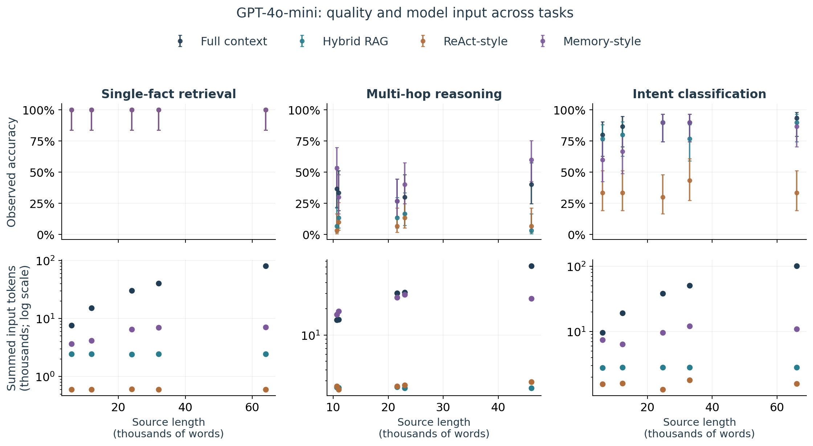

# Effective Context in LLM Systems

**An empirical study across tasks and processing methods**

Mikhail Sadovskiy · Research conducted in **spring 2026**.

How much of a long source can a language-model system use reliably, and what changes when the system retrieves information or uses external memory?

This project examines effective context through three tasks and four processing implementations. It includes 9,800 selected API observations, an operational definition of effective context, and an analysis that separates source length, answer quality, and model-input workload.

**[Read the report](report.md)** · **[Download the PDF](output/pdf/effective_context_report.pdf)** · [Reproduce the results](docs/reproduction.md) · [Inspect the data](data/historical/README.md)



*GPT-4o-mini on single-fact retrieval, multi-hop reasoning, and intent classification. Top: observed accuracy with nominal 95% intervals. Bottom: input tokens summed over model calls. Source length is in words. Points describe tested conditions, not a fitted capacity boundary.*

## Main findings

- **A successful retrieval test does not establish broad context competence.** With full context, GPT-4o-mini answers 100/100 NIAH, 132/150 Banking77, and 50/150 BABILong examples correctly across the selected conditions.
- **Context processing can change workload substantially.** At the longest GPT-4o-mini NIAH condition, full context and memory both score 20/20, using averages of 80,917 and 7,062 total input tokens. Memory makes two calls and produces more output. Equal scores on a small sample do not establish equivalent quality or lower total compute.
- **The experiment does not establish a general context extension.** On BABILong, memory differs from full context by +0.33 percentage points, with an exploratory interval of -4.84 to +5.75. Task-matched length comparisons also remain inconclusive.

The contribution is a reproducible empirical evaluation of specific systems. Effective context remains the central object: the report explains what the observed profiles reveal and why a single largest-passing length would overstate the evidence.

## Study at a glance

| Dimension | Scope |
|---|---|
| Tasks | Numerical retrieval, multi-hop question answering, intent classification |
| Methods | Full context, hybrid RAG, ReAct-style loop, memory-style loop |
| Models | Eight identifiers overall; six per task, with different task-specific sets |
| Observations | 9,800 selected; 9,506 retained after recorded service failures and overflows |
| Sampling limits | 88 underlying BABILong task IDs with prefix dependence; 30 Banking77 queries |
| Outputs | Quality profiles, paired comparisons, task-matched length checks, token workload |

This is a completed independent technical report, not a peer-reviewed publication or a validated universal capacity estimator. Agent procedures are project adaptations, not complete ReAct or MemGPT reproductions. See [Systems and provenance](docs/systems.md).

## Reproduce without model calls

Use Python 3.11 in an isolated environment, then run from the repository root:

```text
python -m pip install -r requirements-analysis-lock.txt
python -m analysis.final_report --out results/reproduced
python -m unittest discover -s tests -p test_final_report.py -v
```

The analysis reads the included observation bundle and source mapping. It requires no API key, model download, or inference service. The [reproduction guide](docs/reproduction.md) describes environment setup, outputs, and PDF generation.

## Repository guide

- [Report](report.md): question, definition, methods, results, and limitations.
- [Analysis](analysis/final_report.py): supported entry point for reproducing results.
- [Data](data/historical/README.md): observation schema, selection, and provenance.
- [Results](results/final/): exact tables and generated figures.
- [Experiment source](experiment/README.md): available implementation snapshot and replay limitations.
- [Supplementary checks](docs/provenance.md): additional validation observations.
- [Attribution](THIRD_PARTY_NOTICES.md): benchmarks, methods, and third-party material.

## Author and contributions

**Mikhail Sadovskiy** ([MortiferumUrsus](https://github.com/MortiferumUrsus)) independently carried out the original study in spring 2026. He formulated the research question, designed the experiments, selected the tasks and comparison conditions, and directed the implementation and analysis.

AI agents assisted with coding, analysis and report preparation. The research direction, experimental decisions and responsibility for the conclusions remained with the author. See [Attribution and assistance](docs/provenance.md#attribution-and-assistance) for details.
