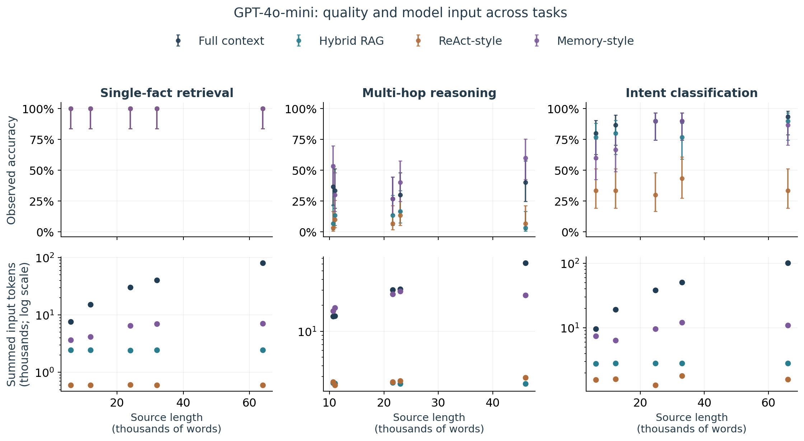
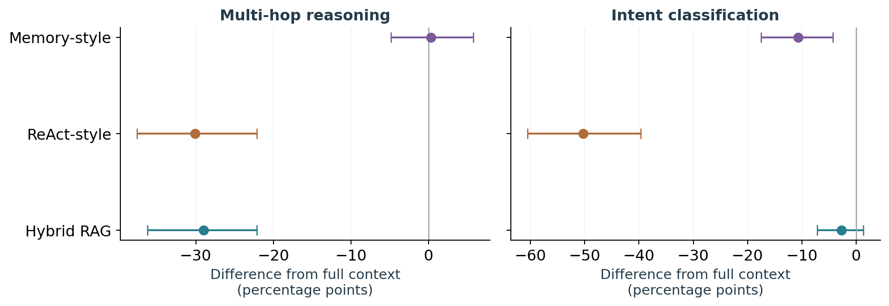
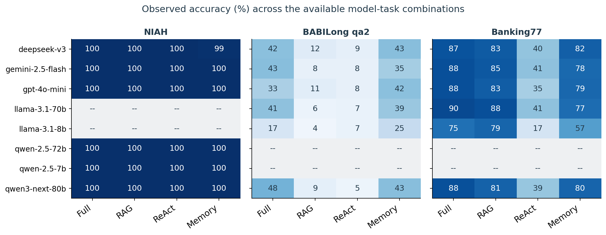
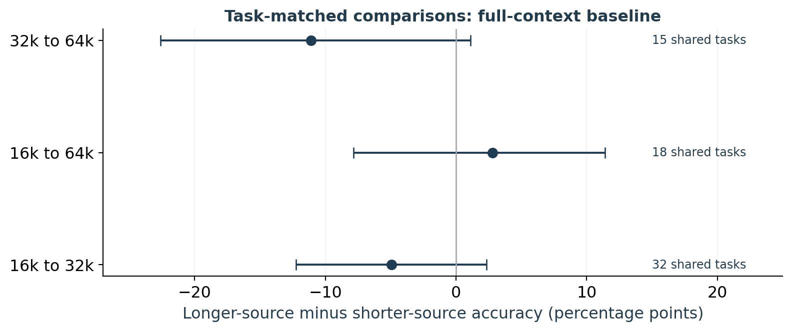

# Effective Context in LLM Systems

## An empirical study across tasks and processing methods

**Mikhail Sadovskiy** · [MortiferumUrsus](https://github.com/MortiferumUrsus)

Research conducted in **spring 2026**.

Independent technical report. [Project repository](https://github.com/MortiferumUrsus/llm-effective-context-research) · [Reproduction instructions](docs/reproduction.md)

### Abstract

Effective context describes how much input a language-model system can use while maintaining specified task performance. This study examines that quantity across three tasks and four implementations: full-context prompting, hybrid retrieval, a ReAct-style loop, and a memory-style loop. The spring experiment contains 9,800 selected API observations across eight model identifiers, with 9,506 retained after recorded service failures and context overflows. Performance differs substantially across tasks. GPT-4o-mini answers all 100 retained single-fact retrieval cases correctly, but only 50 of 150 multi-hop cases. At the longest single-fact condition, full context and memory both answer 20/20 correctly while using averages of 80,917 and 7,062 total input tokens. This workload difference does not establish equivalent quality or general context extension. Across the multi-hop grid, memory differs from full context by +0.33 percentage points, with uncertainty spanning losses and gains. Recovered task-matched length comparisons also remain inconclusive. The results support task-specific observed quality and workload profiles, but do not identify precise capacity boundaries or validate a universal scalar estimator.

## 1. Research question and contribution

A model's context window specifies how many tokens an endpoint accepts. Effective context concerns what a system can do with available information. A long document may fit into a request yet remain difficult to use. Conversely, retrieval or memory may process a large source while supplying only a small part of it to each model call.

The study asks: **how does observed task performance vary with source length and processing procedure, and what do those observations establish about effective context?** The procedures are instruments for studying this question. The project does not introduce a retrieval algorithm.

Three task types provide distinct tests: finding a numerical value, combining facts in a narrative, and classifying an intent from labeled examples. They are reported separately. Success on the simplest task is not treated as a substitute for competence on the others, consistent with the task dependence examined in [HELMET](https://arxiv.org/abs/2410.02694) and [Maximum Effective Context Window](https://arxiv.org/abs/2509.21361).

The contribution is an implemented evaluation framework and an empirical comparison of specific systems, with an explicit account of which context measurements the evidence supports. The release provides selected observations, recovered source-task identities, paired analyses, workload summaries, and reproducible figures. The definition below states the target of measurement; the finite observations are not presented as a validated estimator of that target.

## 2. Defining and reporting effective context

### 2.1 Three different lengths

| Quantity | Meaning |
|---|---|
| Source length, `L` | Size of the document or demonstration set available to a procedure |
| Per-call context | Tokens presented to the model in one request, including instructions and history |
| Total token workload | Input and output tokens summed over all requests in an episode |

For full-context prompting, source length and model input usually increase together. For retrieval and memory they can differ greatly. Answering questions about a large source is a property of the complete system, not proof that the model has acquired a larger native window. Summed tokens measure API workload; they do not measure FLOPs, end-to-end latency, or the complete cost of retrieval.

### 2.2 Operational definition

Fix a model, a processing procedure with its resource limits, a task distribution, and a serving configuration. Let `Q(L)` be expected accuracy at source length `L`. Let `L0` be a short reference condition, `tau` a minimum useful accuracy between zero and one, and `delta` a nonnegative allowed absolute loss from reference accuracy. Over admissible source lengths, one operational definition is:

```text
L_eff = sup {L >= L0 : for every admissible u in [L0, L],
             Q(u) >= tau and Q(u) >= Q(L0) - delta}.
```

The minimum-quality condition prevents a consistently unsuccessful system from receiving a large effective-context value merely because it does not get worse. Requiring quality throughout the interval prevents a late recovery from defining an otherwise unusable range. If the reference condition fails the quality requirement, an effective-context value under this definition is not established.

Tolerances and task construction must be specified before a confirmatory measurement. They are not selected here to obtain favorable rankings. The definition also depends on resource limits: several searches and model calls constitute a different condition from a single request.

### 2.3 What the observations can establish

This report uses observed profiles rather than fitted boundaries. A profile contains accuracy, uncertainty, actual source lengths, availability, and token workload at each condition. Three outcomes matter:

- No decline is observed in the tested conditions: the upper boundary has not been located.
- Quality is already low at the shortest tested condition: without a suitable short reference, the weakness cannot be attributed to length.
- Quality falls and later recovers: the final passing point does not establish a continuously usable interval.

The earlier experiment's descriptive 50% cutoff is retained only as a transparent pattern summary in the accompanying CSV. It is not the `tau` of a validated capacity estimate. No interpolation, extrapolated threshold, inflection point, or five-component fitted profile is used as an empirical finding. Defining effective context and having enough information to estimate it remain separate requirements.

## 3. Experimental material and analysis

### 3.1 Tasks and implementations

The selected observations were collected on 16-18 May 2026. Each task has six evaluated model identifiers, with eight in the union: GPT-4o-mini, Gemini 2.5 Flash, DeepSeek V3, Llama 3.1 8B and 70B, Qwen3 Next 80B, and Qwen 2.5 7B and 72B. The Qwen 2.5 pair appears in NIAH; the Llama pair appears in BABILong and Banking77. This is not a complete eight-model-by-three-task design. Cross-task examples use a model present in all three tasks.

| Task | Construction | Selected / retained | Underlying sample |
|---|---|---:|---|
| NIAH | Retrieve a seven-digit value from repetitive background text | 2,600 / 2,426 | 30 distinct generated values across selected runs |
| BABILong qa2 | Track story facts embedded in natural text | 3,600 / 3,600 | 145 long inputs; 88 source-task IDs |
| Banking77 | Classify a query from labeled demonstrations | 3,600 / 3,480 | 30 queries; 24 of 77 labels |

The latter tasks use [BABILong](https://arxiv.org/abs/2406.10149) and [Banking77](https://arxiv.org/abs/2003.04807). NIAH is a project implementation of the needle-in-a-haystack format. Repeated queries, models, and procedures do not increase the number of independently sampled problems.

| Procedure | Tested implementation |
|---|---|
| Full context | One request containing the available source, subject to the runner's input-fit policy |
| Hybrid RAG | BM25 and BGE-small rankings combined by reciprocal rank fusion; five 380-word chunks with 48-word overlap, in retrieval order |
| ReAct-style | Up to six search/lookup steps over the source, with a final-answer fallback |
| Memory-style | Archival BM25 search with adaptive chunk retrieval, deduplication, task-specific instructions, and a final-answer action |

The agent procedures adapt [ReAct](https://arxiv.org/abs/2210.03629) and [MemGPT](https://arxiv.org/abs/2310.08560); they do not reproduce those complete systems. Instructions, tools, output limits, and call counts differ. Comparisons concern complete implementations under recorded settings, rather than the isolated effect of a memory component. See [Systems and provenance](docs/systems.md).

### 3.2 Lengths and sampling units

The planned ladder used target words, not model tokens. BABILong's nominal 9k and 12k conditions have actual median lengths of about 10.7k and 11.1k words. The nominal 24k and 32k medians are about 21.9k and 22.8k words. The nominal 64k median is about 45.9k words. Figures use measured source words; input tokens are specific to each model and procedure.

Within a model, tier, and episode, methods share the same source hash and reference answer. Across length tiers, selected BABILong tasks and background texts can change. Profiles therefore describe the sampled conditions rather than a manipulation of length alone.

All 145 BABILong inputs were matched to cached source data and their short tasks. Some short stories are exact prefixes of others. Connecting those relations produces 70 derived families, accounting for known dependence without proving independent generator episodes. Banking77 uses test-query identity as its grouping unit.

### 3.3 Scores and uncertainty

The analysis preserves historical binary scores and reports a separate stricter answer-extraction sensitivity check. The old metric label `exact_match` sometimes denotes substring acceptance, not strict string equality.

Recorded provider failures and context overflows account for 294 exclusions. They remain in attempted-call denominators. Conditional accuracy measures correctness among retained records; correct-per-attempt measures success among all selected attempts. Agent answer-format failures remain task outcomes. A separate 240-record failed phase was quarantined before the 9,800-record selection and is outside both denominators.

Individual points use nominal 95% Wilson intervals. Their within-cell independence assumption is limited by related stories. Method differences use 20,000 bootstrap resamples of whole task groups, retaining the fixed models and repeated conditions. BABILong uses derived prefix families. These are exploratory sensitivity intervals, not simultaneous confidence bands or corrections for an unrepresentative sample.

The supported workflow reproduces analysis of saved responses. Historical endpoint aliases and an incompletely captured code state prevent a promise of exact model-run replay. [Reproduction instructions](docs/reproduction.md) specify data, grouping, scoring, and random seeds.

## 4. Results

### 4.1 Task-specific quality profiles

GPT-4o-mini provides a worked example because it appears in all three tasks. Full context scores 100/100 on NIAH, 132/150 on Banking77, and 50/150 on BABILong across the selected spring conditions. Source-length ranges differ, so these are task profiles rather than a controlled estimate of difficulty at one shared length.



*Figure 1. GPT-4o-mini across recorded length conditions. Upper panels: accuracy with nominal Wilson intervals. Lower panels: mean input tokens summed over model calls, on logarithmic axes with different ranges. Points use mean actual source length; coincident outcomes can overlap. These are not fitted capacity curves. NIAH has 20 observations per point; the other tasks have 30.*

NIAH provides no observed degradation boundary for this model in the tested range. BABILong full-context accuracy remains between 26.7% and 40.0%, including at the shortest source condition. That pattern does not locate where an otherwise reliable reasoner stops working. Banking77 accuracy remains relatively high, but without a zero-shot control the study cannot separate learning from demonstrations from prior knowledge of meaningful intent labels.

Appendix A reports every available model-task combination, including missing combinations. It shows saturated numerical retrieval alongside more variable downstream performance.

### 4.2 Processing changes model-input workload

At the longest GPT-4o-mini NIAH condition, full context and memory both answer 20/20 correctly:

| Procedure | Correct / examples | Mean total input tokens | Mean total output tokens |
|---|---:|---:|---:|
| Full context | 20 / 20 | 80,917 | 6.0 |
| Memory-style | 20 / 20 | 7,061.6 | 88.3 |

The memory input total includes both calls in each episode. This demonstrates access to a large source with much less text exposed to the model. It does not establish equivalent quality: a 20/20 proportion still has a nominal Wilson lower bound of about 83.9%. Memory also generates more output and performs retrieval. The table supports an observed workload difference, not verified total-compute or end-to-end latency savings.

The same procedure does not establish an advantage on BABILong. Efficient access to a value and reliable use of several related facts are distinct requirements. The source length supported by a processing system should be reported with its task and observed quality.

### 4.3 Comparisons between methods

| Task | Full context | Hybrid RAG | ReAct-style | Memory-style |
|---|---:|---:|---:|---:|
| BABILong qa2 | 37.33% | 8.33% | 7.22% | 37.67% |
| Banking77 | 85.86% | 83.22% | 35.52% | 75.17% |

These conditional accuracies use the available six-model grid: 900 retained observations per procedure for BABILong and 870 for Banking77. They are not population rankings of method families.



*Figure 2. Procedure accuracy minus full-context accuracy, with exploratory 95% task-cluster sensitivity intervals. Models are a fixed set; repeated evaluations remain within task groups.*

For BABILong, memory differs by +0.33 percentage points, with a prefix-family interval of approximately -4.84 to +5.75. Neither an improvement nor equivalence is established. RAG and ReAct have substantially lower accuracy in these implementations. Their instructions, retrieval behavior, and tools limit conclusions about other implementations. Historical ReAct lookup repeatedly exposed the first match, while retrieved fragments could omit or reorder facts.

For Banking77, RAG differs from full context by -2.64 points, with an interval of approximately -7.13 to +1.38. Memory and ReAct have larger observed losses. The 30 queries and 24 represented labels do not support generalization to the full 77-class distribution.

### 4.4 What task-matched lengths add

Recovered identities allow limited comparisons across BABILong source configurations. Nominal 9k/12k conditions map to the source's `16k` configuration; nominal 24k/32k map to `32k`. Those names are dataset labels, not measured request-token counts. Five identical `32k` inputs were evaluated twice; their scores are averaged without selecting the better answer.

| Source comparison | Shared tasks | Prefix families | Baseline difference, points | Exploratory 95% interval |
|---|---:|---:|---:|---:|
| 16k to 32k | 32 | 27 | -4.95 | [-12.25, +2.32] |
| 16k to 64k | 18 | 16 | +2.78 | [-7.84, +11.40] |
| 32k to 64k | 15 | 14 | -11.11 | [-22.62, +1.11] |

Each shared task-model pair has equal weight, retaining the six fixed models. The three intersections contain different task subsets and must not be joined into a curve. Only eight tasks in seven prefix families occur in all three configurations; their pooled baseline accuracies are 39.6%, 50.0%, and 39.6%.

Matching controls the underlying question, but not the background: all checked cross-configuration pairs have different background texts. None of the baseline sensitivity intervals excludes zero. This improves the description of the saved observations without identifying a clean length effect or precise context boundary.

## 5. Interpretation and limitations

The evidence supports a task- and system-specific account of effective context. On simple retrieval, systems access long sources with very different model-input workloads. On multi-hop reasoning, accuracy is limited even in the shortest historical condition, and memory does not demonstrate an advantage. A single largest-passing length would conceal these distinctions.

The sample is small relative to the call count. Source-length distributions overlap; backgrounds and fact positions change across lengths. Procedures have different prompts, tools, and budgets. Models form a selected fixed set, and aliases do not pin every backend detail. These constraints allow descriptive system comparisons, but not causal claims about architecture, an isolated memory component, or intrinsic capacity.

The stricter scoring sensitivity changes BABILong full-context accuracy from 37.33% to 36.22%, and memory from 37.67% to 37.33%. RAG remains at 8.33%; ReAct changes from 7.22% to 7.11%. Interpretation is unchanged. The conservative rule can reject valid explanatory phrasing and is not substituted after inspecting which method benefits.

Availability also matters. Retained NIAH responses are perfect for full context, RAG, and ReAct; memory misses one case. Across all 650 attempts per procedure, success is 87.38%, 95.08%, 95.38%, and 95.23%, respectively. This includes service and input-limit failures and cannot establish an intrinsic reasoning advantage for retrieval.

Local-model runs are not used to estimate capacity. Some recorded a larger serving window than requested, with input counts reaching the smaller ceiling. The selected API data and supplementary checks are kept distinct. Appendix B summarizes those checks without adding them to the spring sample.

## 6. Conclusion

Effective context requires a specified task, processing procedure, quality requirement, and serving configuration. The experiment provides observed quality and workload profiles, but not a reliable universal boundary. Reduced model-input volume on simple retrieval does not establish improved multi-hop performance. Similar means do not prove preserved quality, and a successful last point does not establish a usable interval below it.

The outcome is a reproducible empirical evaluation with explicit limits on capacity claims. Its analysis reconstructs the reported tables and figures, distinguishes failed requests from task errors, and makes the basis of each comparison inspectable.

## Appendix A. Complete model-task summary



*Figure 3. Conditional accuracy, rounded to whole percentages, over retained conditions. Missing combinations are dashes. Different denominators prevent interpreting this as a complete factorial ranking. Exact values are in `results/final/model_task_accuracy.csv`.*



*Figure 4. The three baseline comparisons from Section 4.4. Labels are source configurations. Intervals resample known prefix families; backgrounds remain a confound.*

## Appendix B. Supplementary checks and provenance

Separate checks were completed after the spring study. They are development evidence, not additional spring observations. A 150-response pilot used GPT-4o-mini on 30 new derived story groups. Full long context scored 12/30; retrieval-order and source-order RAG each scored 4/30; a complete story with matched filler and a short story alone each scored 15/30. The complete-story intervention changed evidence, layout, and distractors together, so it did not isolate a single mechanism.

A subsequent 60-response short-prompt comparison scored 17/30 for a contemporaneous original-prompt replay and 16/30 for the official BABILong prompt. It did not demonstrate improvement. All 210 responses finished normally, with provider input-token counts matching local tokenizer counts. These checks support caution about interpreting low long-input accuracy as a pure length effect.

A separate six-call local check measured input accounting. The same 8,192-word raw prompt was evaluated as 1,024 tokens with a 1,024-token window and as 8,193 tokens with a 16,384-token window. This demonstrates a configuration effect in that check, not reasoning accuracy or the exact historical truncation behavior.

Mikhail Sadovskiy independently formulated the research question, designed the experiments and carried out the original study in spring 2026. He directed the implementation and analysis. AI agents supported coding, analysis and report preparation. The research decisions and responsibility for the conclusions remained with the author. An AI-agent critique was used as an internal check, not external human peer review. Existing benchmarks and source methods are credited below. No new model inference was performed to prepare this final release from saved data. See [Provenance and supplementary checks](docs/provenance.md).

## References

1. Kuratov et al. (2024). [BABILong: Testing the Limits of LLMs with Long Context Reasoning-in-a-Haystack](https://arxiv.org/abs/2406.10149). NeurIPS Datasets and Benchmarks.
2. Casanueva et al. (2020). [Efficient Intent Detection with Dual Sentence Encoders](https://arxiv.org/abs/2003.04807). Source of Banking77.
3. Yao et al. (2023). [ReAct: Synergizing Reasoning and Acting in Language Models](https://arxiv.org/abs/2210.03629). ICLR.
4. Packer et al. (2023). [MemGPT: Towards LLMs as Operating Systems](https://arxiv.org/abs/2310.08560).
5. Yen et al. (2025). [HELMET: How to Evaluate Long-Context Language Models Effectively and Thoroughly](https://arxiv.org/abs/2410.02694). ICLR.
6. Paulsen (2026 revision). [Context Is What You Need: The Maximum Effective Context Window for Real World Limits of LLMs](https://arxiv.org/abs/2509.21361).
